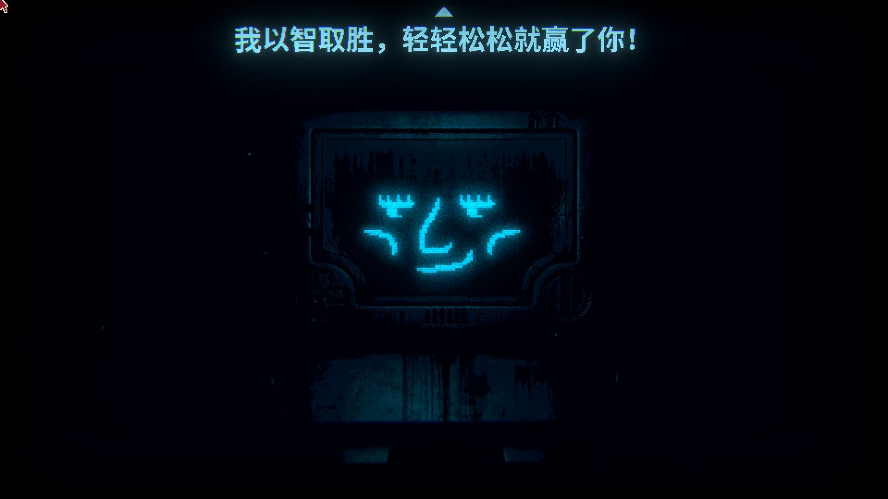

# Clock Particle Wallpaper

一个用于 Wallpaper Engine 的蓝黑色网页壁纸，显示系统时间，并在画面两侧提供随音频变化的频谱条。

## 背景预览

下面是背景图片；时钟和音频频谱在运行时叠加显示。

## 当前版本功能

- 同步本机系统时间，显示十二小时制时间、中文上下午、星期和秒数。
- 左右两侧显示音频频谱条，无音频输入时逐渐隐去。
- 支持在 Wallpaper Engine 中调整音频灵敏度。
- 根据窗口宽度调整时钟布局和频谱条数量。

## 性能

- 频谱动画遵循 Wallpaper Engine 性能设置中的 FPS 限制；普通浏览器预览默认以 30 FPS 更新频谱。
- 静音后频谱逐渐隐去并停止动画刷新；再次收到有效音频时自动恢复，时钟仍每秒更新。
- 频谱使用缩放变换，避免逐帧修改宽度引发布局计算，并复用音频数据缓冲区。

可按流畅度需求在 Wallpaper Engine 中选择 15 或 30 FPS，并设置其他应用全屏时暂停壁纸。源码更新后，需要在 Wallpaper Engine 编辑器中重新加载并保存项目，创意工坊订阅版本不会随 GitHub 更新自动替换。

## 使用方法

1. 下载本仓库：点击 GitHub 页面上的 **Code → Download ZIP**，然后完整解压；也可以用 Git 克隆。
2. 使用 Wallpaper Engine 的壁纸编辑器，以网页壁纸方式打开项目中的 `index.html`，并保留同目录下的样式、脚本和图片文件。
3. 预览并应用壁纸，播放系统音频即可查看两侧频谱效果；可在壁纸属性中调整 **Audio sensitivity**。

当前 `project.json` 指定的入口是 `index.html`。直接用普通浏览器打开它可以预览背景和时钟；音频响应依赖 Wallpaper Engine 提供的音频接口。

## 文件说明

| 文件 | 用途 |
| --- | --- |
| `index.html` | 当前项目入口 |
| `script-audio-edge.js` | 时钟、两侧音频频谱及灵敏度设置 |
| `style.css` | 背景、时钟和频谱布局 |
| `project.json` | Wallpaper Engine 项目配置 |
| `background.jpg` | 当前网页实际使用的背景 |
| `background_1664x936.jpg` | 项目配置中指定的预览图 |
| `index_audio_publish.html` | 保留的发布入口，与上传时的 `index.html` 内容相同 |
| `index - 副本.html`、`script.js` | 保留的历史页面及粒子脚本 |
| `generate_wallpaper.py` | 可选的静态图片生成脚本，需要 Python、Pillow 和本机中文字体 |
| `wallpaper_glow_particles.png`、`微信图片_20250731092713.jpg` | 保留的图片素材 |
| `UPDATE_GUIDE.md`、`WORKSHOP_TEXT_CN.md` | 原有的更新说明与创意工坊文案，部分描述对应历史版本 |

## 修改与更新

主要修改 `index.html`、`script-audio-edge.js` 和 `style.css`，随后在 Wallpaper Engine 中预览效果。若使用备用发布页面，需要同时同步相应改动。

GitHub 用于保存和分享项目源文件；Steam 创意工坊的发布与更新需在 Wallpaper Engine 中另行完成。
